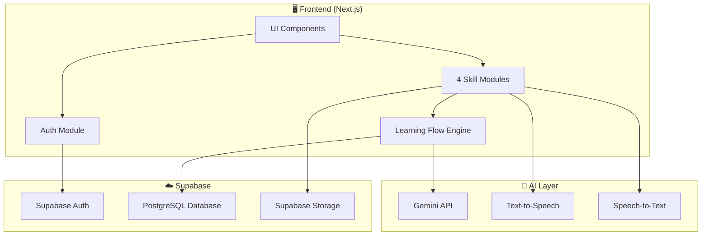
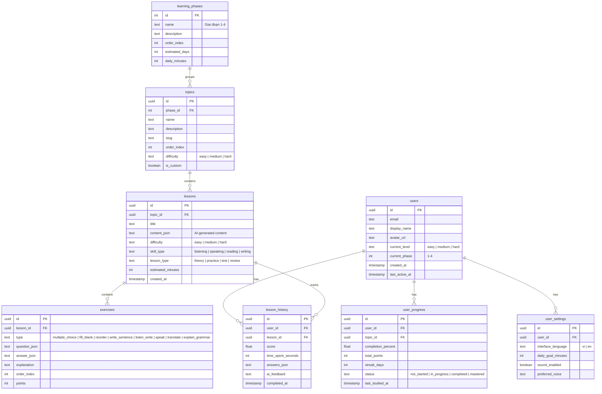
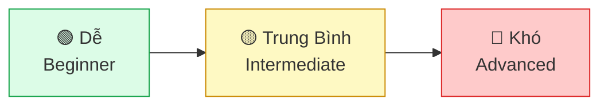
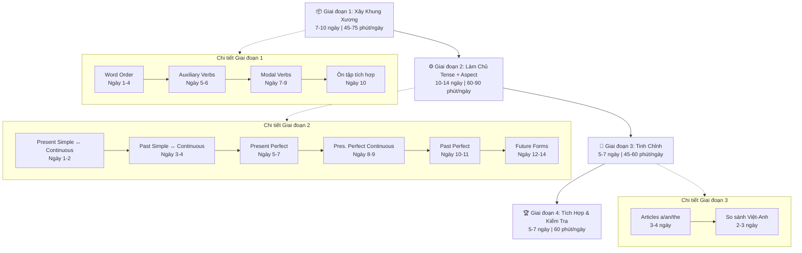
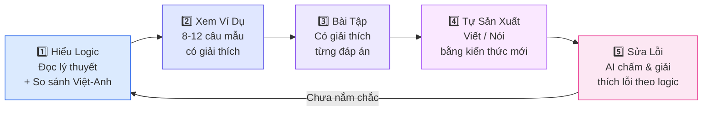
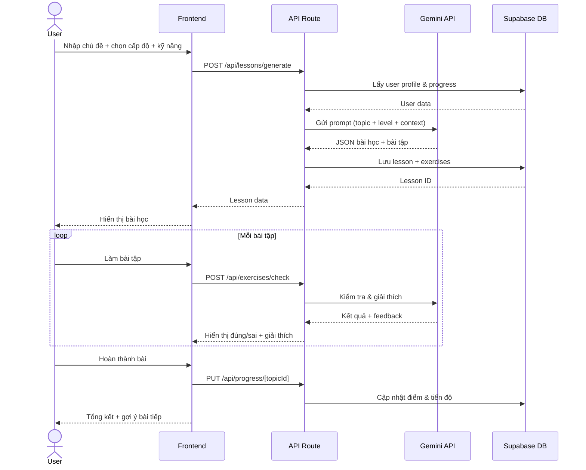
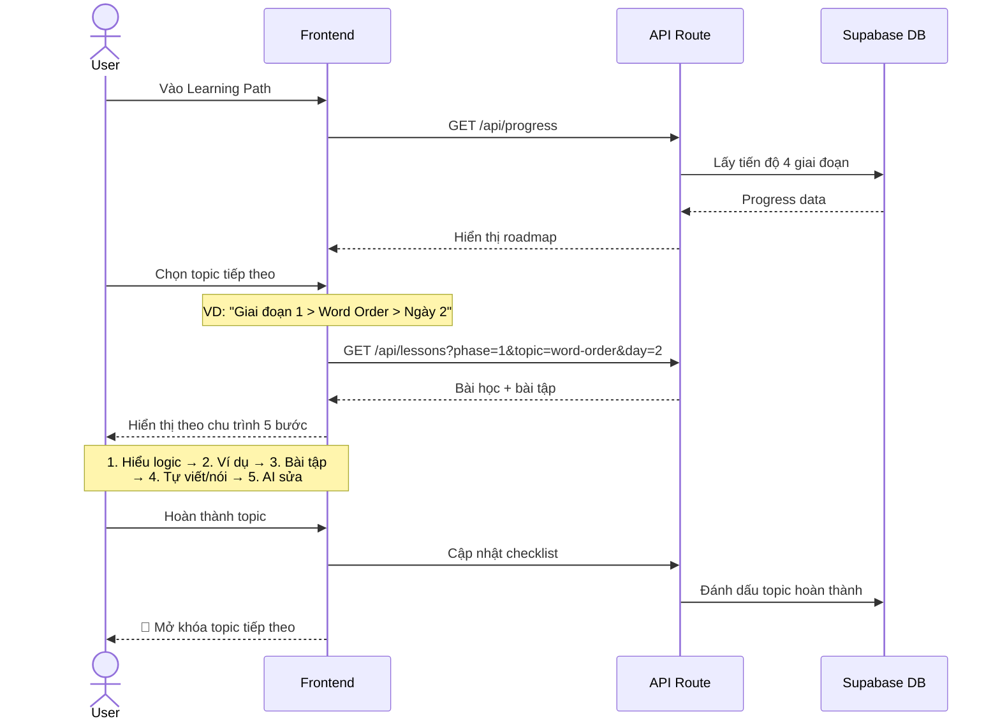

# 📚 English Mastery – App Học Tiếng Anh IELTS

## Tổng Quan

**English Mastery** là ứng dụng web học tiếng Anh theo phong cách IELTS, tập trung vào 4 kỹ năng Nghe – Nói – Đọc – Viết, kết hợp với lộ trình học logic "5 Đầu Mục Cốt Lõi". App sử dụng AI để sinh bài học phù hợp theo chủ đề, cấp độ, và tiến độ cá nhân.

> [!IMPORTANT]
> App hướng đến người mới bắt đầu học tiếng Anh, ưu tiên **hiểu logic** hơn **học thuộc**.

---

## 1. Tech Stack

| Thành phần | Công nghệ |
|---|---|
| **Frontend** | Next.js 14 (App Router) + TypeScript |
| **UI Library** | Tailwind CSS + shadcn/ui |
| **Backend / API** | Next.js API Routes + Server Actions |
| **Auth** | Supabase Auth (Email/Password, Google OAuth) |
| **Database** | Supabase PostgreSQL |
| **Storage** | Supabase Storage (audio files, user recordings) |
| **AI / Sinh bài** | Google Gemini API (sinh bài học, chấm điểm, phản hồi) |
| **Text-to-Speech** | Web Speech API / Google Cloud TTS |
| **Speech-to-Text** | Web Speech API / Whisper API |
| **State Management** | Zustand |
| **Deployment** | Vercel |

---

## 2. Kiến Trúc Hệ Thống



---

## 3. Database Schema



---

## 4. Tính Năng Chi Tiết

### 4.1. 🔐 Đăng Nhập / Đăng Ký (Supabase Auth)

- **Phương thức:**
  - Email + Password
  - Đăng nhập bằng Google (OAuth)
- **Flow:**
  1. Trang `/login` – form đăng nhập
  2. Trang `/register` – form đăng ký (tên, email, password)
  3. Sau đăng ký → chọn cấp độ (Dễ / Trung bình / Khó) → tạo profile
  4. Email xác thực qua Supabase
- **Bảo mật:**
  - Row Level Security (RLS) trên mọi bảng
  - Session token qua Supabase client
  - Middleware kiểm tra auth trên các route bảo vệ

### 4.2. 🏠 Trang Chủ / Dashboard

```
┌─────────────────────────────────────────────────┐
│  👋 Xin chào, [Tên]!                            │
│  🔥 Streak: 5 ngày   ⭐ Điểm: 1,250             │
├─────────────────────────────────────────────────┤
│                                                  │
│  📊 Tiến Độ Học Tập                              │
│  ┌──────────────────────────────────┐            │
│  │ Giai đoạn 1: ████████░░ 80%     │            │
│  │ Giai đoạn 2: ███░░░░░░░ 30%     │            │
│  │ Giai đoạn 3: ░░░░░░░░░░  0%     │            │
│  │ Giai đoạn 4: ░░░░░░░░░░  0%     │            │
│  └──────────────────────────────────┘            │
│                                                  │
│  📝 Bài Học Hôm Nay                              │
│  ┌─────────────────┐ ┌─────────────────┐        │
│  │ Word Order      │ │ Articles Quiz   │        │
│  │ 🟢 Dễ  ⏱ 15p   │ │ 🟡 TB  ⏱ 20p   │        │
│  │ [Bắt đầu]      │ │ [Bắt đầu]      │        │
│  └─────────────────┘ └─────────────────┘        │
│                                                  │
│  🔍 Nhập Chủ Đề Bất Kỳ                          │
│  ┌──────────────────────────┐ [Tạo bài]         │
│  │ VD: Cách dùng mạo từ... │                    │
│  └──────────────────────────┘                    │
│                                                  │
│  📈 Thống Kê Tuần                                │
│  [Nghe: 2h] [Nói: 1h] [Đọc: 3h] [Viết: 1.5h]  │
└─────────────────────────────────────────────────┘
```

**Các thành phần:**
- **Header:** Avatar, tên, streak, tổng điểm
- **Thanh tiến độ:** Hiển thị 4 giai đoạn học
- **Bài học gợi ý:** Dựa trên tiến độ hiện tại + AI đề xuất
- **Ô nhập chủ đề:** Cho phép nhập chủ đề tự do → AI sinh bài
- **Thống kê:** Thời gian học theo từng kỹ năng

### 4.3. 🎯 Sinh Bài Học Theo Chủ Đề (AI-Powered)

Đây là tính năng cốt lõi – người dùng nhập một chủ đề bất kỳ, AI sẽ sinh ra bài học hoàn chỉnh.

**Input từ người dùng:**
```
┌──────────────────────────────────────────┐
│  📝 Nhập chủ đề muốn học:                │
│  ┌────────────────────────────────────┐  │
│  │ Cách xác định mạo từ a/an/the     │  │
│  └────────────────────────────────────┘  │
│                                          │
│  Cấp độ:  ● Dễ  ○ Trung bình  ○ Khó    │
│                                          │
│  Kỹ năng tập trung:                     │
│  ☑ Đọc  ☑ Viết  ☐ Nghe  ☐ Nói          │
│                                          │
│  [✨ Tạo Bài Học]                        │
└──────────────────────────────────────────┘
```

**AI sinh ra bài học gồm:**

| Phần | Nội dung | Thời gian |
|---|---|---|
| **1. Giải thích logic** | Lý thuyết ngắn gọn, dùng so sánh Việt–Anh, ví dụ cụ thể | 5–10 phút |
| **2. Ví dụ minh họa** | 8–12 câu ví dụ có highlight ngữ pháp, giải thích tại sao | 5 phút |
| **3. Bài tập tương tác** | Multiple choice, điền từ, sắp xếp, viết câu (tùy kỹ năng) | 10–15 phút |
| **4. Thử thách** | Viết đoạn / Nói / Nghe đoạn văn liên quan chủ đề | 10 phút |
| **5. Tổng kết & Feedback** | AI chấm điểm, giải thích lỗi, gợi ý cải thiện | 5 phút |

**Prompt template cho Gemini (ví dụ):**
```
Bạn là giáo viên tiếng Anh chuyên dạy người Việt Nam. 
Hãy tạo bài học về chủ đề: "{topic}"
Cấp độ: {difficulty}
Kỹ năng: {skills}

Yêu cầu:
1. Giải thích logic, KHÔNG dạy thuộc lòng. So sánh với tiếng Việt khi cần.
2. Cho 8-12 ví dụ có giải thích chi tiết.
3. Tạo 10 bài tập tương tác (dạng: {exercise_types}).
4. Một bài thử thách thực hành.
5. Phản hồi chi tiết cho từng câu trả lời sai.

Trả về JSON theo schema: {...}
```

**Ví dụ chủ đề người dùng có thể nhập:**
- "Cách xác định mạo từ a/an/the"
- "Viết thành 1 câu hoàn chỉnh từ các từ rời"
- "Các thì trong tiếng Anh – Present Perfect vs Past Simple"
- "Phân biệt will và be going to"
- "Cách dùng modal verbs: can, could, must"
- "Thứ tự tính từ trong tiếng Anh"
- "Lỗi phổ biến do tư duy tiếng Việt"

### 4.4. 📖 4 Kỹ Năng Chi Tiết

#### 4.4.1. 🎧 Listening (Nghe)

**Các dạng bài:**

| Dạng | Mô tả | Cấp độ |
|---|---|---|
| **Nghe & chọn đáp án** | Nghe đoạn ngắn, chọn A/B/C/D | Dễ |
| **Nghe & điền từ** | Nghe câu/đoạn, điền từ thiếu | Dễ – TB |
| **Nghe & viết lại** (Dictation) | Nghe câu, viết lại hoàn chỉnh | TB |
| **Nghe & trả lời câu hỏi** | Nghe đoạn dài, trả lời câu hỏi | TB – Khó |
| **Nghe & tóm tắt** | Nghe bài nói, viết tóm tắt | Khó |

**Tính năng:**
- Tốc độ nghe: 0.5x / 0.75x / 1x / 1.25x
- Nghe lại từng câu riêng biệt
- Hiển thị transcript sau khi làm bài
- AI đọc bài bằng giọng tự nhiên (TTS)
- Highlight từ/cụm đang được đọc (karaoke style)

#### 4.4.2. 🗣️ Speaking (Nói)

**Các dạng bài:**

| Dạng | Mô tả | Cấp độ |
|---|---|---|
| **Đọc to câu** | Đọc câu hiển thị trên màn hình | Dễ |
| **Nói theo mẫu** | Nghe mẫu → nói lại | Dễ – TB |
| **Trả lời câu hỏi ngắn** | AI hỏi, người dùng trả lời | TB |
| **Mô tả hình ảnh** | Xem ảnh, nói mô tả | TB – Khó |
| **Thảo luận chủ đề** | Nói 1–2 phút về chủ đề cho trước | Khó |

**Tính năng:**
- Ghi âm giọng nói qua trình duyệt
- Speech-to-Text chuyển thành văn bản
- AI phân tích: phát âm, ngữ pháp, từ vựng, mạch lạc
- Cho điểm & gợi ý cải thiện
- So sánh câu nói của user vs câu mẫu

#### 4.4.3. 📖 Reading (Đọc)

**Các dạng bài:**

| Dạng | Mô tả | Cấp độ |
|---|---|---|
| **Đọc & chọn đáp án** | Đọc đoạn ngắn, trả lời multiple choice | Dễ |
| **Đọc & True/False/Not Given** | Xác định thông tin đúng/sai | TB |
| **Đọc & matching** | Nối heading/thông tin với đoạn văn | TB |
| **Đọc & điền vào tóm tắt** | Điền từ thiếu vào bản tóm tắt | TB – Khó |
| **Phân tích cấu trúc câu** | Xác định S/V/O, thì, mạo từ trong đoạn | Dễ – Khó |

**Tính năng:**
- Highlight từ vựng → hiện nghĩa + phiên âm
- Phân tích ngữ pháp từng câu (click vào câu → xem cấu trúc)
- Đánh dấu từ mới → thêm vào danh sách từ vựng cá nhân
- AI tạo đoạn văn theo chủ đề & cấp độ phù hợp

#### 4.4.4. ✍️ Writing (Viết)

**Các dạng bài:**

| Dạng | Mô tả | Cấp độ |
|---|---|---|
| **Sắp xếp từ thành câu** | Cho từ rời, xếp thành câu đúng | Dễ |
| **Viết câu từ gợi ý** | Cho keywords, viết câu hoàn chỉnh | Dễ – TB |
| **Sửa lỗi câu** | Tìm & sửa lỗi ngữ pháp trong câu | TB |
| **Dịch Việt → Anh** | Dịch câu, AI so sánh & chấm | TB |
| **Viết đoạn văn ngắn** | Viết 80–150 từ theo chủ đề | TB – Khó |
| **Viết essay** | Viết 200–250 từ (IELTS Task 2 style) | Khó |

**Tính năng:**
- Editor với word count, timer
- AI chấm bài theo tiêu chí IELTS: Task Response, Coherence, Lexical Resource, Grammar
- Highlight lỗi trực tiếp trên bài viết (gạch đỏ = lỗi, gạch vàng = có thể cải thiện)
- Gợi ý câu viết lại tốt hơn
- So sánh bài viết của user vs bài mẫu

---

### 4.5. 📐 Cấp Độ Khó

Ba cấp độ áp dụng cho mọi bài học và bài tập:



| Tiêu chí | 🟢 Dễ | 🟡 Trung Bình | 🔴 Khó |
|---|---|---|---|
| **Từ vựng** | Cơ bản, phổ biến (~500 từ) | Giao tiếp thường ngày (~2000 từ) | Học thuật, IELTS (~4000+ từ) |
| **Ngữ pháp** | SVO đơn, 1-2 thì | Câu phức, 6-8 thì | Mọi cấu trúc, câu phức tạp |
| **Độ dài đoạn** | 2–4 câu | 5–10 câu | 1–3 đoạn văn |
| **Tốc độ nghe** | Chậm (0.75x) | Bình thường (1x) | Nhanh (1.25x) |
| **Gợi ý** | Nhiều gợi ý, dịch song ngữ | Ít gợi ý, từ khóa | Không gợi ý |
| **Giải thích** | Tiếng Việt + Tiếng Anh | Chủ yếu Tiếng Anh | 100% Tiếng Anh |
| **Thời gian** | Không giới hạn | Có timer tham khảo | Giới hạn thời gian |

**Cơ chế tự động điều chỉnh:**
- Nếu đúng ≥ 85% liên tục 3 bài → gợi ý tăng cấp độ
- Nếu sai ≥ 50% → gợi ý giảm cấp độ hoặc ôn lại
- Người dùng luôn có thể tự chọn cấp độ

---

### 4.6. 🗺️ Lộ Trình Học – 5 Đầu Mục Cốt Lõi

Tích hợp trực tiếp từ kế hoạch "5 Đầu Mục Cốt Lõi" vào app dưới dạng **Learning Path** có cấu trúc.

#### Tổng quan 4 Giai Đoạn



#### Chu trình học mỗi chủ điểm

Mỗi topic trong lộ trình tuân theo chu trình 5 bước:



#### Checklist theo dõi tiến độ (trong app)

Hiển thị dưới dạng checklist tương tác, đánh dấu khi "tự động" (hiểu & dùng đúng không cần nghĩ):

- [ ] Word Order: SVO + Place/Time + thứ tự tính từ
- [ ] Câu hỏi Yes/No và Wh- thành thạo
- [ ] Auxiliary do/be/have đúng trong câu hỏi & phủ định
- [ ] Modal cơ bản (can, must, should, will, would)
- [ ] Present Simple ↔ Continuous
- [ ] Past Simple ↔ Continuous
- [ ] Present Perfect vs Past Simple (điểm khó nhất)
- [ ] Present Perfect Continuous
- [ ] Past Perfect & Past Perfect Continuous
- [ ] Các cách diễn đạt tương lai
- [ ] Articles a/an/the/zero
- [ ] Nhận biết lỗi do tư duy tiếng Việt & tự sửa

---

## 5. Cấu Trúc Thư Mục

```
learning-english/
├── public/
│   ├── images/
│   └── sounds/
├── src/
│   ├── app/
│   │   ├── (auth)/
│   │   │   ├── login/
│   │   │   │   └── page.tsx
│   │   │   ├── register/
│   │   │   │   └── page.tsx
│   │   │   └── layout.tsx
│   │   ├── (main)/
│   │   │   ├── dashboard/
│   │   │   │   └── page.tsx
│   │   │   ├── learn/
│   │   │   │   ├── [topicId]/
│   │   │   │   │   └── page.tsx          # Bài học theo topic
│   │   │   │   └── custom/
│   │   │   │       └── page.tsx          # Sinh bài từ chủ đề tự nhập
│   │   │   ├── practice/
│   │   │   │   ├── listening/
│   │   │   │   │   └── page.tsx
│   │   │   │   ├── speaking/
│   │   │   │   │   └── page.tsx
│   │   │   │   ├── reading/
│   │   │   │   │   └── page.tsx
│   │   │   │   └── writing/
│   │   │   │       └── page.tsx
│   │   │   ├── progress/
│   │   │   │   └── page.tsx              # Checklist & thống kê
│   │   │   ├── review/
│   │   │   │   └── page.tsx              # Ôn tập spaced repetition
│   │   │   ├── settings/
│   │   │   │   └── page.tsx
│   │   │   └── layout.tsx
│   │   ├── api/
│   │   │   ├── lessons/
│   │   │   │   ├── generate/
│   │   │   │   │   └── route.ts          # AI sinh bài học
│   │   │   │   └── [id]/
│   │   │   │       └── route.ts
│   │   │   ├── exercises/
│   │   │   │   ├── check/
│   │   │   │   │   └── route.ts          # AI chấm bài
│   │   │   │   └── feedback/
│   │   │   │       └── route.ts          # AI phản hồi chi tiết
│   │   │   ├── speech/
│   │   │   │   ├── tts/
│   │   │   │   │   └── route.ts
│   │   │   │   └── stt/
│   │   │   │       └── route.ts
│   │   │   └── progress/
│   │   │       └── route.ts
│   │   ├── layout.tsx
│   │   └── page.tsx                      # Landing page
│   ├── components/
│   │   ├── ui/                           # shadcn/ui components
│   │   ├── auth/
│   │   │   ├── LoginForm.tsx
│   │   │   ├── RegisterForm.tsx
│   │   │   └── AuthProvider.tsx
│   │   ├── dashboard/
│   │   │   ├── ProgressOverview.tsx
│   │   │   ├── DailyLessons.tsx
│   │   │   ├── TopicInput.tsx
│   │   │   └── StatsChart.tsx
│   │   ├── lesson/
│   │   │   ├── LessonView.tsx
│   │   │   ├── TheorySection.tsx
│   │   │   ├── ExampleList.tsx
│   │   │   └── LessonComplete.tsx
│   │   ├── exercises/
│   │   │   ├── MultipleChoice.tsx
│   │   │   ├── FillBlank.tsx
│   │   │   ├── ReorderWords.tsx
│   │   │   ├── WriteSentence.tsx
│   │   │   ├── ListenAndWrite.tsx
│   │   │   ├── SpeakExercise.tsx
│   │   │   ├── TranslateExercise.tsx
│   │   │   └── GrammarAnalysis.tsx
│   │   ├── skills/
│   │   │   ├── AudioPlayer.tsx
│   │   │   ├── VoiceRecorder.tsx
│   │   │   ├── ReadingPassage.tsx
│   │   │   ├── WritingEditor.tsx
│   │   │   └── FeedbackPanel.tsx
│   │   ├── learning-path/
│   │   │   ├── PhaseMap.tsx
│   │   │   ├── TopicCard.tsx
│   │   │   ├── ChecklistTracker.tsx
│   │   │   └── DayPlan.tsx
│   │   └── common/
│   │       ├── Header.tsx
│   │       ├── Sidebar.tsx
│   │       ├── Timer.tsx
│   │       ├── ScoreBadge.tsx
│   │       └── DifficultySelector.tsx
│   ├── lib/
│   │   ├── supabase/
│   │   │   ├── client.ts                 # Browser client
│   │   │   ├── server.ts                 # Server client
│   │   │   ├── middleware.ts             # Auth middleware
│   │   │   └── database.types.ts         # Generated types
│   │   ├── gemini/
│   │   │   ├── client.ts                 # Gemini API client
│   │   │   ├── prompts.ts                # Prompt templates
│   │   │   └── schemas.ts                # Response schemas
│   │   ├── speech/
│   │   │   ├── tts.ts                    # Text-to-Speech utils
│   │   │   └── stt.ts                    # Speech-to-Text utils
│   │   └── utils/
│   │       ├── scoring.ts                # Tính điểm
│   │       └── learning-path.ts          # Logic lộ trình
│   ├── hooks/
│   │   ├── useAuth.ts
│   │   ├── useLesson.ts
│   │   ├── useExercise.ts
│   │   ├── useAudio.ts
│   │   ├── useVoiceRecorder.ts
│   │   └── useProgress.ts
│   ├── stores/
│   │   ├── authStore.ts
│   │   ├── lessonStore.ts
│   │   └── progressStore.ts
│   └── types/
│       ├── lesson.ts
│       ├── exercise.ts
│       ├── user.ts
│       └── learning-path.ts
├── supabase/
│   ├── migrations/
│   │   ├── 001_create_users.sql
│   │   ├── 002_create_learning_phases.sql
│   │   ├── 003_create_topics.sql
│   │   ├── 004_create_lessons.sql
│   │   ├── 005_create_exercises.sql
│   │   ├── 006_create_user_progress.sql
│   │   ├── 007_create_lesson_history.sql
│   │   └── 008_seed_learning_path.sql    # Seed 4 giai đoạn + topics
│   └── config.toml
├── .env.local
├── next.config.js
├── tailwind.config.ts
├── tsconfig.json
├── package.json
└── README.md
```

---

## 6. API Endpoints

### 6.1. Auth (Supabase built-in)

| Method | Endpoint | Mô tả |
|---|---|---|
| POST | `/auth/signup` | Đăng ký (Supabase) |
| POST | `/auth/signin` | Đăng nhập (Supabase) |
| POST | `/auth/signout` | Đăng xuất |
| GET | `/auth/callback` | OAuth callback (Google) |

### 6.2. Lessons

| Method | Endpoint | Mô tả |
|---|---|---|
| POST | `/api/lessons/generate` | Sinh bài học mới từ chủ đề + cấp độ |
| GET | `/api/lessons/[id]` | Lấy chi tiết bài học |
| GET | `/api/lessons?phase=1&topic=word-order` | Lấy danh sách bài theo filter |

### 6.3. Exercises

| Method | Endpoint | Mô tả |
|---|---|---|
| POST | `/api/exercises/check` | Kiểm tra đáp án + AI giải thích |
| POST | `/api/exercises/feedback` | Phản hồi chi tiết cho writing/speaking |
| GET | `/api/exercises?lesson_id=xxx` | Lấy bài tập của lesson |

### 6.4. Progress

| Method | Endpoint | Mô tả |
|---|---|---|
| GET | `/api/progress` | Tiến độ tổng quan |
| PUT | `/api/progress/[topicId]` | Cập nhật tiến độ topic |
| GET | `/api/progress/checklist` | Lấy checklist 12 mục |

### 6.5. Speech

| Method | Endpoint | Mô tả |
|---|---|---|
| POST | `/api/speech/tts` | Chuyển text thành audio |
| POST | `/api/speech/stt` | Chuyển audio thành text |

---

## 7. Luồng Hoạt Động Chính

### 7.1. Flow: Sinh bài học từ chủ đề tùy chọn



### 7.2. Flow: Học theo lộ trình 5 Đầu Mục Cốt Lõi



---

## 8. Giao Diện Chính (Wireframes)

### 8.1. Trang Bài Học

```
┌─────────────────────────────────────────────────┐
│  ← Quay lại    📖 Articles: a/an/the     🟢 Dễ  │
│  ━━━━━━━━━━━━━━━━━━━━━━━━━━━━━━━━━━━━━━━━━━━━━ │
│  [Lý thuyết] [Ví dụ] [Bài tập] [Thử thách]     │
│  ─────────────────────────────────────────────── │
│                                                  │
│  📐 Hiểu Logic                                   │
│  ┌─────────────────────────────────────────────┐ │
│  │ Mạo từ trong tiếng Anh giúp xác định:      │ │
│  │                                             │ │
│  │ 🔹 a/an → Người nghe CHƯA biết đối tượng   │ │
│  │    "I saw a dog" = một con chó (chưa biết   │ │
│  │    con nào)                                 │ │
│  │                                             │ │
│  │ 🔹 the → Người nghe ĐÃ biết đối tượng      │ │
│  │    "I saw the dog" = con chó (mà cả 2 đều  │ │
│  │    biết)                                    │ │
│  │                                             │ │
│  │ 💡 So sánh với tiếng Việt:                  │ │
│  │    Tiếng Việt dùng "một" vs "cái/con đó"   │ │
│  │    nhưng thường bỏ qua. Tiếng Anh BẮT BUỘC │ │
│  │    phải có.                                 │ │
│  └─────────────────────────────────────────────┘ │
│                                                  │
│  ⏱️ 3/15 phút    📊 Bước 1/5                     │
│  [◀ Trước]                        [Tiếp theo ▶] │
└─────────────────────────────────────────────────┘
```

### 8.2. Trang Bài Tập

```
┌─────────────────────────────────────────────────┐
│  Câu 3/10                        ⏱️ 02:30       │
│  ━━━━━━━━━━━━━━━━━━━━━━━━━━━━━━━━━━━━━━━━━━━━━ │
│                                                  │
│  Chọn mạo từ đúng:                              │
│  "I want to buy ___ new phone."                  │
│                                                  │
│  ┌──────────┐  ┌──────────┐  ┌──────────┐       │
│  │   ● a    │  │   ○ an   │  │   ○ the  │       │
│  └──────────┘  └──────────┘  └──────────┘       │
│                                                  │
│  ┌─────────────────────────────────────────────┐ │
│  │ ✅ Chính xác!                                │ │
│  │                                             │ │
│  │ Dùng "a" vì:                                │ │
│  │ • "phone" là danh từ đếm được, số ít        │ │
│  │ • "new" bắt đầu bằng phụ âm → dùng "a"     │ │
│  │ • Người nghe chưa biết phone nào cụ thể     │ │
│  │   → chưa xác định → a/an                   │ │
│  └─────────────────────────────────────────────┘ │
│                                                  │
│  ████████░░░░░░░░░░░░  3/10 câu                  │
│  [Câu tiếp theo →]                               │
└─────────────────────────────────────────────────┘
```

---

## 9. Environment Variables

```env
# Supabase
NEXT_PUBLIC_SUPABASE_URL=https://xxxxx.supabase.co
NEXT_PUBLIC_SUPABASE_ANON_KEY=eyJhbGci...
SUPABASE_SERVICE_ROLE_KEY=eyJhbGci...

# Gemini AI
GEMINI_API_KEY=AIza...

# Google Cloud (optional - for TTS)
GOOGLE_CLOUD_TTS_API_KEY=AIza...

# App
NEXT_PUBLIC_APP_URL=http://localhost:3000
```

---

## 10. Seed Data – Lộ Trình Mặc Định

App sẽ có sẵn lộ trình "5 Đầu Mục Cốt Lõi" được seed vào database:

```sql
-- Giai đoạn 1
INSERT INTO learning_phases (id, name, description, order_index, estimated_days, daily_minutes)
VALUES
  (1, 'Xây Khung Xương', 'Word Order + Auxiliary & Modal', 1, 10, 60),
  (2, 'Làm Chủ Tense + Aspect', 'Hệ thống 12 thì theo logic 3 trục × 4 aspect', 2, 14, 75),
  (3, 'Tinh Chỉnh', 'Articles + So sánh Việt-Anh', 3, 7, 50),
  (4, 'Tích Hợp & Kiểm Tra', 'Biến kiến thức thành kỹ năng tự động', 4, 7, 60);

-- Topics cho Giai đoạn 1
INSERT INTO topics (phase_id, name, description, slug, order_index) VALUES
  (1, 'Word Order - Nguyên lý SVO', 'Thứ tự từ quyết định chức năng ngữ pháp', 'word-order-svo', 1),
  (1, 'Word Order - Mở rộng', 'S+V+O+Place+Time, thứ tự tính từ', 'word-order-extended', 2),
  (1, 'Word Order - Câu hỏi', 'Yes/No questions, Wh- questions', 'word-order-questions', 3),
  (1, 'Word Order - Câu phức', 'Liên từ: because, although, when, if...', 'word-order-complex', 4),
  (1, 'Auxiliary: do/be/have', 'Trợ động từ tạo câu hỏi, phủ định, thì', 'auxiliary-verbs', 5),
  (1, 'Modal Verbs', 'can, could, may, might, must, should, will, would', 'modal-verbs', 6),
  (1, 'Ôn tập Giai đoạn 1', 'Viết đoạn văn tích hợp Word Order + Aux + Modal', 'phase1-review', 7);

-- ... tương tự cho Giai đoạn 2, 3, 4
```

---

## 11. Nguyên Tắc Thiết Kế UI/UX

1. **Mobile-first** – responsive, hoạt động tốt trên điện thoại
2. **Giao diện tiếng Việt** – mọi hướng dẫn bằng tiếng Việt (giải thích ngữ pháp song ngữ)
3. **Gamification nhẹ** – streak, điểm, huy hiệu khi hoàn thành giai đoạn
4. **Dark mode** – hỗ trợ học ban đêm
5. **Offline-capable** – cache bài học đã tải (PWA)
6. **Micro-interactions** – animation khi trả lời đúng/sai, hoàn thành bài
7. **Accessibility** – font size tùy chỉnh, high contrast mode

---

## 12. Kế Hoạch Phát Triển

### Phase 1 – MVP (2-3 tuần)
- [x] Setup Next.js + Supabase + Tailwind
- [ ] Auth: đăng nhập/đăng ký (email + Google)
- [ ] Dashboard cơ bản
- [ ] Sinh bài học từ chủ đề (Gemini API)
- [ ] 3 dạng bài tập: multiple choice, fill blank, reorder
- [ ] Lộ trình 5 Đầu Mục (hiển thị + theo dõi tiến độ)
- [ ] Cấp độ Dễ/TB/Khó

### Phase 2 – Core Skills (2-3 tuần)
- [ ] Reading module đầy đủ
- [ ] Writing module + AI chấm bài
- [ ] Listening module (TTS + bài tập nghe)
- [ ] Thêm dạng bài tập: translate, write sentence, grammar analysis

### Phase 3 – Speaking & Polish (2 tuần)
- [ ] Speaking module (ghi âm + STT + AI feedback)
- [ ] Spaced repetition review
- [ ] Thống kê chi tiết
- [ ] Dark mode + PWA

### Phase 4 – Enhancement (ongoing)
- [ ] Vocabulary notebook
- [ ] Community features (chia sẻ bài viết)
- [ ] IELTS mock tests
- [ ] Leaderboard

---

> [!TIP]
> Bắt đầu với **Phase 1 MVP** – tập trung vào Auth + Dashboard + Sinh bài AI + Lộ trình học. Đây là giá trị cốt lõi của app.

---

## 13. Lệnh Khởi Tạo Dự Án

```bash
# Tạo project Next.js
npx create-next-app@latest learning-english --typescript --tailwind --eslint --app --src-dir

# Cài dependencies
npm install @supabase/supabase-js @supabase/ssr
npm install @google/generative-ai
npm install zustand
npm install lucide-react
npx shadcn@latest init

# Cài shadcn components
npx shadcn@latest add button card input label tabs progress badge dialog select textarea toast

# Dev
npm run dev
```

